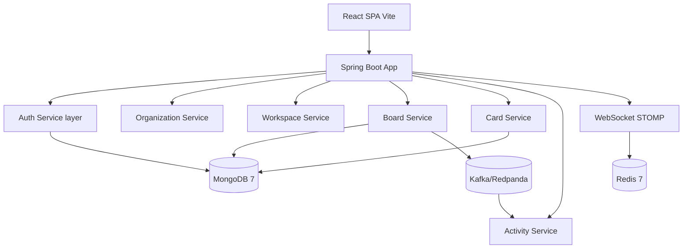
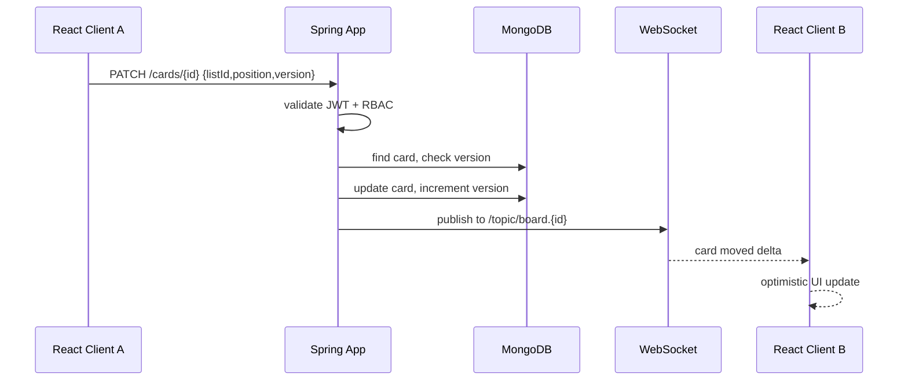
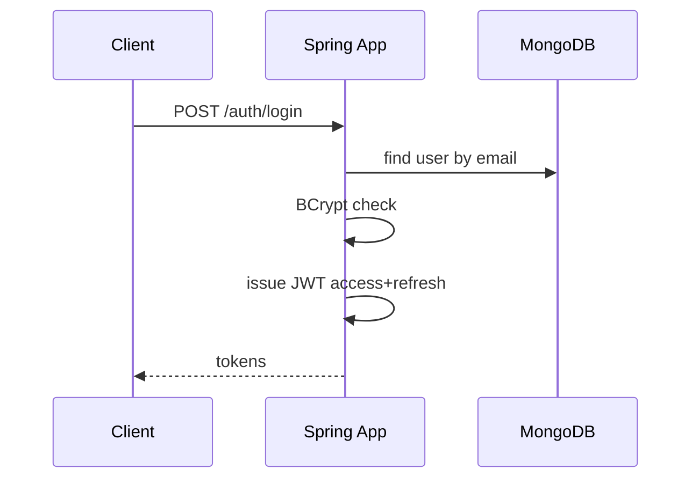

# 02-system-design

## Architecture overview
Client React SPA → HTTPS/WSS → Nginx/Reverse proxy → Spring Boot monolith exposes REST + WebSocket STOMP.
Services in code: Auth, Organization, Membership, Workspace, Board, List, Card, Comment, Activity.
Data: MongoDB for persistence, Redis for presence/sessions, Kafka for event bus (deferred to in-process for MVP).
UX target: Trello/Notion-like collaboration with instant navigation, optimistic updates, drag-drop, presence indicators.

## Components and responsibilities
API Gateway: Spring Boot app with Spring Security JWT filter, routes /api/** and /ws.
Auth Service: register/login/refresh/me, BCrypt, JWT generation/validation.
Organization Service: create org, list members, role assignment.
Workspace Service: CRUD workspaces under org, member checks.
Board Service: CRUD boards, lists, cards, comments. Optimistic concurrency via version. Emits domain events for activity.
Realtime Service: WebSocket STOMP config, topic subscriptions /topic/board.{id}, presence via Redis SETEX, broadcast deltas for live collaboration.
Activity Service: append-only activities collection, query feed.
Frontend: React SPA with optimistic UI, drag-drop, presence indicators, client-side routing for instant navigation.

## Data model
Entities use UUID @Id, @Document collection mapping.
users { UUID id, email indexed unique, name, passwordHash, avatarUrl, createdAt, updatedAt }
organizations { UUID id, slug unique, name, createdBy, createdAt }
memberships { UUID id, organizationId, userId, role enum, joinedAt } index org+user unique
workspaces { UUID id, organizationId, name, description, createdBy, createdAt, updatedAt }
boards { UUID id, workspaceId, title, description, createdBy, createdAt, updatedAt, archived }
lists TaskList { UUID id, boardId, title, position, createdAt }
cards { UUID id, listId, boardId, title, description, position, assignees[], labels[], dueDate, version, createdBy, createdAt, updatedAt }
comments { UUID id, cardId, authorId, body, createdAt, updatedAt }
activities { UUID id, workspaceId, boardId, actorId, type enum, entityId, metadata, createdAt }
Indexes: {email:1 unique}, {organizationId:1,userId:1 unique}, {workspaceId:1,createdAt:-1}, {boardId:1,position:1}, etc.

MongoDB guarantees: atomic per document, no multi-document ACID; design avoids cross-document transactions.

## API list
Auth
POST /api/auth/register {email,name,password} → 201 UserResponse
POST /api/auth/login {email,password} → 200 {accessToken,refreshToken}
POST /api/auth/refresh {refreshToken} → 200 {accessToken}
GET /api/auth/me → 200 UserResponse
Roles: anyone / authenticated

Organizations
GET /api/organizations → 200 []
POST /api/organizations {name,slug} → 201
GET /api/organizations/{id} → 200
PATCH /api/organizations/{id} → 200
Roles: OWNER

Memberships
GET /api/organizations/{orgId}/members → 200 []
POST /api/organizations/{orgId}/members {userId,role} → 201
PATCH /api/organizations/{orgId}/members/{userId} {role} → 200
DELETE /api/organizations/{orgId}/members/{userId} → 204
Roles: OWNER/ADMIN

Workspaces
GET /api/workspaces?orgId= → 200 []
POST /api/workspaces {organizationId,name,description} → 201
GET /api/workspaces/{id} → 200
PATCH /api/workspaces/{id} → 200
DELETE /api/workspaces/{id} → 204
Roles: MEMBER+

Boards
GET /api/workspaces/{workspaceId}/boards → 200 []
POST /api/workspaces/{workspaceId}/boards {title,description} → 201
GET /api/boards/{id} → 200
PATCH /api/boards/{id} → 200
DELETE /api/boards/{id} → 204

Lists
GET /api/boards/{boardId}/lists → 200 []
POST /api/boards/{boardId}/lists {title,position} → 201
PATCH /api/lists/{id} → 200
DELETE /api/lists/{id} → 204

Cards
GET /api/boards/{boardId}/cards?listId= → 200 []
POST /api/boards/{boardId}/lists/{listId}/cards {title,description,position,assignees} → 201
GET /api/cards/{id} → 200
PATCH /api/cards/{id} {title,description,position,listId,assignees,labels,dueDate,version} → 200
DELETE /api/cards/{id} → 204

Comments
GET /api/cards/{cardId}/comments → 200 []
POST /api/cards/{cardId}/comments {body} → 201
PATCH /api/comments/{id} {body} → 200
DELETE /api/comments/{id} → 204

Activity Feed
GET /api/workspaces/{workspaceId}/activities?limit=&cursor= → 200 []
GET /api/boards/{boardId}/activities?limit=&cursor= → 200 []

WebSocket
Connect /ws?token=JWT
Subscribe /topic/workspace.{workspaceId}, /topic/board.{boardId}, /topic/card.{cardId}
Send /app/board.{boardId}.move-card {cardId,fromListId,toListId,position}
Send /app/board.{boardId}.update-card {cardId,patch,version}

## Sequence diagrams
Card move live

Auth login

## Security design
Authentication: JWT access 15m, refresh 7d, signed with HS256, validated by JwtAuthenticationFilter.
Authorization: Spring Security @PreAuthorize, role checks against membership collection cached in Redis.
Secrets: stored in environment variables, never in repo. application.yml uses ${MONGODB_URI}.
CORS: allowed origin http://localhost:5173.
WebSocket: token in query param validated at CONNECT.
Password hashing: BCryptPasswordEncoder.

## Key technical decisions
Spring Boot monolith with layered services: simplicity for MVP, IoC via constructor injection, Repository pattern, DTO+Mapper with MapStruct.
MongoDB with UUID ids: flexible schema for boards/lists/cards, easy evolution.
Optimistic locking via version field on Card: prevents lost updates, avoids DB locks.
WebSocket STOMP over SockJS: low latency live updates, fits React client for Trello/Notion feel.
Optimistic UI on client: immediate feedback on drag-drop, reconciles on server validation.
Event-driven activity feed: Board service emits domain events → Activity service materializes feed.
Rejected alternatives:
- Separate microservices per domain → over-engineering for MVP.
- SQL relational → less flexible for hierarchical board schema.
- Webhooks instead of WebSocket → higher latency.
- Server-side rendering for SPA → unnecessary for private SaaS collaboration.

## Principles and patterns applied
Pattern | Where | Why
Repository | repository/*Repository | abstraction over MongoDB
DTO + Mapper | dto/*, mapper/* | decouple entities from API
Builder | entity @Builder | clear object creation
Strategy | JwtUtil / SecurityConfig | interchangeable auth strategies
Observer / Event | WebSocketEventHandler | decoupled broadcast for live updates
Facade | AuthController | simplify security API
Proxy / Decorator | JwtAuthenticationFilter | cross-cutting auth
Optimistic UI | Frontend store + STOMP | instant feedback like Trello/Notion

## Database guarantees
MongoDB provides atomicity per single document. Multi-document operations are not atomic without transactions. Design uses single-document updates for cards with version field. No multi-document transactions required for MVP. State noted as per ACID section.
